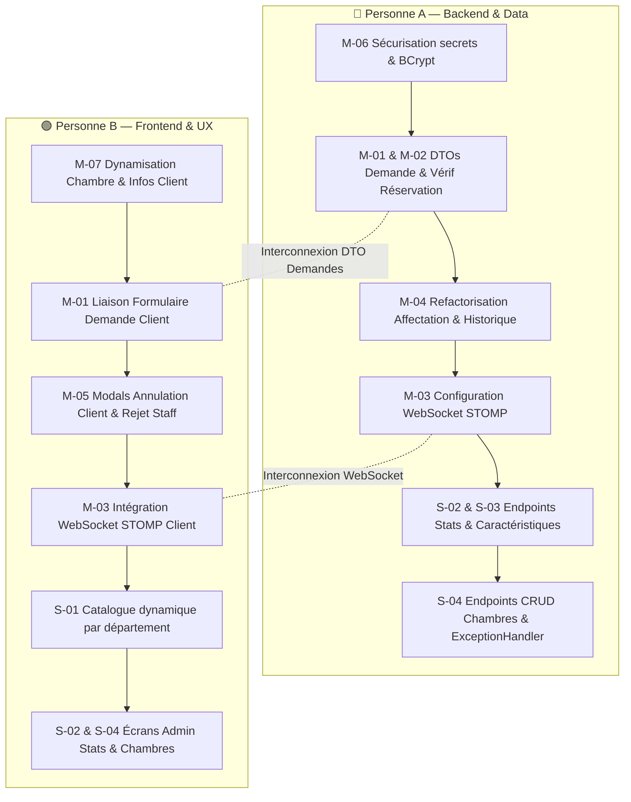

# 🏨 RAPPORT D'AUDIT TECHNIQUE ET FONCTIONNEL
**Projet :** Plateforme de Digitalisation des Services Intra-Hôteliers (`hotel-services`)  
**Rôle :** Auditeur Technique Senior  
**Date d'audit :** 8 novembre 2026  
**Périmètre audité :** Code source réel du Backend (Spring Boot 4.1.1 / Java 21) et du Frontend (Angular 20 Standalone)  
**Méthodologie :** Analyse statique exhaustive en lecture seule, confrontation stricte au Cahier des Charges (CDC) sur la base de preuves tangibles (fichiers, classes, méthodes, lignes de code).

---

## 1. Résumé Exécutif

### 1.1 Taux d'avancement global
Sur les **22 exigences et règles métier** issues du cahier des charges :
- **Fonctionnalités TERMINÉES (Backend + Frontend complets et reliés) :** **4 / 22** (**18,2 %**)
- **Fonctionnalités PARTIELLES (implémentation partielle, UI mockée ou endpoint isolé) :** **13 / 22** (**59,1 %**)
- **Fonctionnalités ABSENTES (aucun code effectif) :** **5 / 22** (**22,7 %**)

```
Avancement Global : [████░░░░░░░░░░░░░░░░] 18,2 % Terminé
État réel : Architecture socle et écrans principaux en place, mais flux métier critiques non finalisés, rupture de chaîne de données et absence de temps réel.
```

### 1.2 Top 5 des manques les plus critiques
1. **Absence totale de synchronisation temps réel et de notification du personnel (CDC07, CDC08)** :
   Le backend ne contient aucune configuration WebSocket/STOMP (dépendance absente du `pom.xml`), et le frontend ne fait aucun polling. Le personnel de terrain et les superviseurs ne reçoivent aucune notification lorsqu'une nouvelle demande arrive dans leur département.
2. **Rupture de la chaîne de données sur les demandes clients (CDC05)** :
   L'écran client dispose d'un champ de description (`customNotes`), mais le DTO frontend (`CreateDemandeDto`), le DTO backend (`DemandeRequest`) et le service backend (`DemandeService.create`) ignorent totalement ce champ. Les précisions saisies par le client sont jetées à la soumission.
3. **Absence de contrôle d'éligibilité de séjour avant création de demande** :
   Le endpoint `POST /api/demandes` ne vérifie à aucun moment si le client dispose d'une réservation active englobant la date actuelle. Pire, `DemandeService.java` bascule par défaut sur le client `1L` si le client n'est pas trouvé.
4. **Perte de l'historique d'affectation et incohérence du schéma relationnel (CDC10)** :
   L'entité `Affectation` n'est jamais instanciée ni sauvegardée lors de l'assignation d'une tâche (`StaffService.assignTask`). En cause : l'entité JPA lie obligatoirement un `Receptionniste` et un `Agent`, alors que la nouvelle logique métier confie l'attribution au `Personnel` (Superviseur) vers un `Employe`.
5. **Failles de sécurité majeures et secrets en clair** :
   Le mot de passe d'application SMTP Gmail est stocké en clair dans `application.properties` (`wyog gezf xemw heef`), le secret JWT est codé en dur, `SecurityConfig.java` intègre un fallback acceptant les mots de passe non hashés en clair, et `UtilisateurService.create` stocke les mots de passe sans aucun encodage BCrypt. Enfin, aucune gestion globale des exceptions (`@ControllerAdvice`) ni rate limiting ne sont configurés.

---

## 2. Tableau Principal de Conformité Fonctionnelle

**Légende des statuts :**
- **TERMINEE** : Backend ET Frontend complets, fonctionnels et reliés entre eux.
- **PARTIELLE** : Une couche seulement (ex: endpoint sans écran, ou écran avec données en dur/mockées).
- **ABSENTE** : Aucune preuve tangible trouvée dans le code source.

| ID | Exigence du Cahier des Charges | Statut | Preuve Backend | Preuve Frontend | Reste à faire |
|:---|:---|:---:|:---|:---|:---|
| **CDC01** | Accès client via code unique lié à la réservation | **TERMINEE** | `AuthController.java:39` (`POST /api/auth/guest-access`), `AuthService.java:74` (`guestLogin`), `JwtUtil.java:38` (`generateGuestToken`). | `LoginComponent.html:15-37` (onglet code séjour), `AuthService.ts:59` (`guestLogin`), `app.routes.ts:17` (`roleGuard('CLIENT')`). | Néant. Le flux est complet et interconnecté. |
| **CDC02** | Expiration automatique du code d'accès au check-out | **PARTIELLE** | `AuthService.java:80-112` vérifie `isRevoked()`, `dateExpiration.isBefore()`, `dateFin.isBefore()`, et incrémente `nbrUtilisations`. `AdminReservationService.java:118` définit l'expiration à `dateFin 23:59:59`. | `LoginComponent.ts:54-61` affiche les messages d'erreur 403 renvoyés par l'API. | Aucun job planifié (`@Scheduled`) n'expire automatiquement les réservations passées ou ne révoque les tokens en base de données. |
| **CDC03** | Connexion personnel login/mot de passe, rôles, JWT | **TERMINEE** | `AuthController.java:25` (`POST /api/auth/login`), `SecurityConfig.java:44-68`, `JwtAuthFilter.java:32`, `UserDetailsServiceImpl.java:22`. | `LoginComponent.html:40-75` (onglet personnel), `AuthService.ts:41` (`login`), `jwt.interceptor.ts:11`, `auth.guard.ts:8`, `role.guard.ts:11`. | Néant. L'authentification et le contrôle d'accès RBAC sont pleinement opérationnels. |
| **CDC04** | Choix d'un service dans une liste catégorisée par département | **PARTIELLE** | `ServiceController.java:24,43` (`GET /api/services`, `GET /api/services/departement/{id}`), `Departement.java:36`. | `ClientDashboardComponent.ts:67-158` définit **6 cartes de service codées en dur** avec catégorie fixe `'SERVICE EN CHAMBRE'`. | Rendre l'affichage du catalogue dynamique par département (onglets Restauration, Housekeeping, Technique) au lieu de cartes statiques. |
| **CDC05** | Ajout d'une description à la demande client | **PARTIELLE** | `Demande.java:79` possède `commentairesClient`, mais `DemandeRequest.java` n'a pas ce champ, et `DemandeService.java:79-97` ne l'enregistre pas. | `ClientDashboardComponent.html:111-118` affiche un textarea `customNotes`, mais `submitDemand()` (`.ts:379-385`) **ne l'envoie pas** dans le DTO. | Ajouter `commentairesClient` dans `CreateDemandeDto` (front), `DemandeRequest` (back) et `DemandeService.create`. |
| **CDC06** | Confirmation immédiate après soumission avec référence unique | **TERMINEE** | `Demande.java:90-103` (`prePersist`), `DemandeService.java:88-95` génère la référence unique `DEM-...`. | `ClientDashboardComponent.ts:390` affiche un toast de confirmation immédiat avec le numéro de référence généré. | Néant. Le feedback et la référence sont validés. |
| **CDC07** | Suivi du statut en temps réel (WebSocket ou polling) | **ABSENTE** | Aucune preuve trouvée. Dépendance WebSocket absente du `pom.xml`, aucun broker STOMP configuré. | Aucune preuve trouvée. Aucun service WebSocket, aucun polling (`interval`/`timer`). | Intégrer `spring-boot-starter-websocket`, configurer STOMP côté backend, et implémenter `rx-stomp` ou un intervalle de polling côté Angular. |
| **REQ-ANNUL** | Annulation d'une demande par le client et historique | **PARTIELLE** | `Demande.java:56` (`motifAnnulation`), `DemandeController.java:33` (`PUT /api/demandes/{id}`), `DemandeService.java:105`. | `ClientDashboardComponent.ts:236-298` affiche l'historique filtrable. **Aucun bouton ni modal d'annulation** sur l'écran client. | Ajouter un bouton "Annuler ma demande" avec saisie de `motifAnnulation` sur le dashboard client et brancher sur `PUT /api/demandes/{id}`. |
| **REQ-RES-ACT** | Vérification que la réservation est active avant demande | **ABSENTE** | `DemandeService.java:51-98` ne consulte jamais `ReservationRepository`. Fallback en dur sur client `1L` si inconnu. | `ClientDashboardComponent.ts:364-403` ne vérifie pas les dates ou le statut de la réservation. | Vérifier dans `DemandeService.create` que le client possède une réservation au statut `EN_COURS` avec `today` entre `dateDebut` et `dateFin`. |
| **CDC08** | Notification du personnel à chaque nouvelle demande | **ABSENTE** | `DemandeService.java:97` et `StaffService.java:371` sauvegardent sans notifier. `NotificationRepository.java` n'est jamais injecté. | Aucune cloche ni écouteur d'événements de notification sur les dashboards Employé et Personnel. | Créer une entité `Notification` et envoyer un message WebSocket sur `/topic/departement/{id}` lors de la création d'une demande. |
| **CDC09** | Changement de statut par le personnel avec jalons et temps réel | **PARTIELLE** | `StaffService.java:105` (`claimTask` -> `EN_COURS`, `datePriseEnCharge`), `StaffService.java:134` (`completeTask` -> `TERMINEE`, `dateResolution`, `tempsTraitementReel`). | `EmployeDashboardComponent.html:93,105` boutons "Prendre en charge" et "Terminer ✓". | `dateDebutTraitement` n'est jamais valorisé ; le statut `PRISE_EN_CHARGE` est sauté ; aucun bouton pour déclarer une tâche bloquée. |
| **CDC10** | Réaffectation de tâche avec historique (entité Affectation) | **PARTIELLE** | `StaffController.java:61`, `StaffService.java:242` (`assignTask`). Met à jour `demande.employeAssigne`. **L'entité `Affectation` n'est jamais créée**. | `PersonnelDashboardComponent.html:184-230` modal de sélection de l'employé et confirmation d'affectation. | Réusiner `Affectation.java` pour relier `Personnel` et `Employe`, et instancier/sauvegarder une `Affectation` dans `assignTask`. |
| **REQ-RECEP** | Rôle Réceptionniste : supervision, affectation et rejet avec motif | **PARTIELLE** | `StaffController.java:79-105` : vue d'ensemble KPIs, table globale filtrable, création de secours. **Aucun endpoint d'affectation ni de rejet**. | `ReceptionDashboardComponent.html` : KPIs, table filtrable et création. **Aucun bouton d'affectation ni de rejet**. | Ajouter à l'espace réceptionniste la possibilité d'affecter une demande non prise et d'en rejeter une avec saisie obligatoire de `motifRejet`. |
| **REQ-DISPO** | Gestion de la disponibilité des agents | **PARTIELLE** | `StaffService.java:224-237` calcule la disponibilité à la volée (`inProgress == 0`). `Agent.disponible` en base n'est jamais mis à jour. | `PersonnelDashboardComponent.html:139` affiche un badge "Disponible" / "Occupé" calculé, mais sans action possible. | Ajouter un endpoint et un bouton pour permettre aux employés et superviseurs de basculer manuellement leur disponibilité (pause, service terminé). |
| **CDC11** | CRUD des services, départements et caractéristiques | **PARTIELLE** | `ServiceController.java` (CRUD complet), `DepartementController.java` (CRUD complet). `CaracteristiquesRepository.java` n'a **aucun controller**. | `AdminCrudComponent.html:112-258` : onglets Services et Départements complets. **Caractéristiques totalement absentes**. | Développer `CaracteristiquesController`, DTOs associés, et ajouter la gestion des caractéristiques dans l'onglet Services de l'Admin. |
| **CDC12** | Statistiques (temps moyen de traitement, volume/service, volume/dpt) | **PARTIELLE** | `StaffService.java:280` fournit uniquement des compteurs basiques (total, en attente, alertes). Aucun calcul de moyennes ou de groupements. | `ReceptionDashboardComponent.html:59-88` affiche 6 cartes KPIs. **Aucune statistique dans l'espace Admin**. | Créer un endpoint `GET /api/admin/statistics` avec requêtes SQL d'agrégation (`AVG(tempsTraitementReel)`, `COUNT GROUP BY`) et écran dédié. |
| **CDC13** | Gestion des comptes du personnel et de leurs rôles | **TERMINEE** | `AdminUtilisateurController.java:15-70` (CRUD complet + assign/unassign département), `AdminUtilisateurService.java:62-180`. | `AdminCrudComponent.html:324-440` (liste filtrable, modal création/édition avec sélection rôle et département, suppression). | Néant. Le module d'administration du personnel est complet et opérationnel. |
| **REQ-CHAMB-RES** | CRUD Chambres/Réservations & génération code d'accès | **PARTIELLE** | `AdminReservationController.java:34` (`createReservation` avec génération code, QR code Base64, token, email). `ChambreController.java` n'a pas de `PUT`/`DELETE`. | `AdminCrudComponent.html:36-110` (création réservation, Pass Numérique QR code). **Aucune interface CRUD pour les chambres**. | Ajouter les méthodes `PUT`/`DELETE` dans `ChambreController` et créer un onglet de gestion des chambres dans `AdminCrudComponent`. |
| **REQ-NOTIF** | Notifications intra-système (création, envoi, lecture, statut) | **PARTIELLE** | Entité `Notification.java` et repository complets. `EmailNotificationService.java` envoie l'email SMTP. **Aucun service intra-application**. | `ClientDashboardComponent.ts:62` variable `showNotifications` ouvrant un panneau statique sans données réelles. | Créer `NotificationService` et `NotificationController` pour persister, distribuer et marquer comme lues les notifications utilisateurs. |
| **REQ-SEC** | Sécurité (HTTPS, BCrypt, Rate limiting, CORS, @Valid, Exceptions) | **PARTIELLE** | CORS configuré (`SecurityConfig:74`), BCrypt actif. Mais HTTPS absent, Rate limiting absent, `@ControllerAdvice` absent, fallback mot de passe en clair. | `jwt.interceptor.ts`, `auth.guard.ts`, `role.guard.ts` actifs. | Supprimer le fallback mot de passe en clair, créer un `@RestControllerAdvice`, ajouter HTTPS et un filtre de rate limiting (Bucket4j). |
| **REQ-I18N-MOB** | Multilingue (`languePreferee`) et interface responsive mobile-first | **PARTIELLE** | Colonne `languePreferee` dans `Client.java`. Aucun bundle de messages internationalisé (`messages.properties`). | SCSS mobile-first très soigné (`@media (max-width: 768px)`, flexbox, styles soignés). **Aucun module i18n, 100% en français en dur**. | Installer `@ngx-translate` ou configurer Angular i18n avec sélecteur de langue FR/EN synchronisé avec le profil client. |
| **REQ-TESTS** | Tests unitaires et d'intégration | **ABSENTE** | Un unique test de démonstration dans `HotelServicesBackendApplicationTests.java:11` (`testPasswordEncoding`). 0 test d'API, 0 test de service. | Un seul fichier `app.spec.ts` par défaut qui échoue car il recherche un titre `h1` supprimé du template. 0 test de composant. | Mettre en place les tests unitaires et MockMvc côté Spring Boot, et les tests unitaires Jasmine/Karma côté Angular. |

---

## 3. Inventaire Exhaustif du Code Existant

### 3.1 Inventaire des Endpoints REST réellement présents dans le Backend

| Méthode | URL | Contrôleur Backend | Rôles Autorisés (`SecurityConfig`) | Description & Remarque |
|:---|:---|:---|:---|:---|
| `POST` | `/api/auth/login` | `AuthController` | Public (`permitAll`) | Authentification personnel/admin avec retour JWT |
| `POST` | `/api/auth/guest-access` | `AuthController` | Public (`permitAll`) | Connexion client par code séjour et génération JWT |
| `GET` | `/api/demandes` | `DemandeController` | Authentifié | Liste de toutes les demandes |
| `GET` | `/api/demandes/client/{clientId}` | `DemandeController` | Authentifié | Liste des demandes d'un client (fallback client 1) |
| `GET` | `/api/demandes/{id}` | `DemandeController` | Authentifié | Détail d'une demande par ID |
| `POST` | `/api/demandes` | `DemandeController` | Authentifié | Création d'une demande (sans vérif réservation) |
| `PUT` | `/api/demandes/{id}` | `DemandeController` | Authentifié | Mise à jour statut, priorités et motifs |
| `DELETE` | `/api/demandes/{id}` | `DemandeController` | Authentifié | Suppression d'une demande |
| `GET` | `/api/staff/employe/my-tasks` | `StaffController` | `EMPLOYE`, `STAFF`, `ADMIN` | Tâches assignées à l'employé connecté |
| `GET` | `/api/staff/employe/available-pool` | `StaffController` | `EMPLOYE`, `STAFF`, `ADMIN` | Tâches simples non assignées du département |
| `POST` | `/api/staff/employe/tasks/{id}/claim` | `StaffController` | `EMPLOYE`, `STAFF`, `ADMIN` | Auto-prise en charge d'une tâche simple |
| `POST` | `/api/staff/employe/tasks/{id}/complete` | `StaffController` | `EMPLOYE`, `STAFF`, `ADMIN` | Clôture d'une tâche et calcul temps réel |
| `GET` | `/api/staff/personnel/department-tasks` | `StaffController` | `PERSONNEL`, `ADMIN` | Tâches supervisées du département |
| `GET` | `/api/staff/personnel/team` | `StaffController` | `PERSONNEL`, `ADMIN` | Équipe d'employés avec disponibilité calculée |
| `POST` | `/api/staff/personnel/tasks/{id}/assign` | `StaffController` | `PERSONNEL`, `ADMIN` | Affectation d'une tâche supervisée à un employé |
| `GET` | `/api/staff/personnel/alerts` | `StaffController` | `PERSONNEL`, `ADMIN` | Liste des demandes en retard de SLA du département |
| `GET` | `/api/staff/reception/overview` | `StaffController` | `RECEPTIONNISTE`, `ADMIN` | KPIs globaux (total, attente, alertes retard) |
| `GET` | `/api/staff/reception/demandes` | `StaffController` | `RECEPTIONNISTE`, `ADMIN` | Listing transversal avec recherche et filtres |
| `GET` | `/api/staff/reception/room-guests` | `StaffController` | `RECEPTIONNISTE`, `ADMIN` | Liste des clients et chambres en séjour actif |
| `POST` | `/api/staff/reception/create-demand` | `StaffController` | `RECEPTIONNISTE`, `ADMIN` | Création de demande de secours par la réception |
| `GET` | `/api/services` | `ServiceController` | Authentifié | Liste de tous les services de l'hôtel |
| `GET` | `/api/services/{id}` | `ServiceController` | Authentifié | Détail d'un service |
| `POST` | `/api/services` | `ServiceController` | `ADMIN` | Création d'un service intra-hôtelier |
| `PUT` | `/api/services/{id}` | `ServiceController` | `ADMIN` | Modification d'un service existant |
| `PATCH` | `/api/services/{id}/toggle` | `ServiceController` | `ADMIN` | Activation/Désactivation de la disponibilité |
| `DELETE` | `/api/services/{id}` | `ServiceController` | `ADMIN` | Suppression d'un service |
| `GET` | `/api/services/disponibles` | `ServiceController` | Authentifié | Services actuellement disponibles |
| `GET` | `/api/services/departement/{id}` | `ServiceController` | Authentifié | Services rattachés à un département |
| `GET` | `/api/departements` | `DepartementController` | Authentifié | Liste de tous les départements |
| `GET` | `/api/departements/{id}` | `DepartementController` | Authentifié | Détail d'un département |
| `POST` | `/api/departements` | `DepartementController` | `ADMIN` | Création d'un département |
| `PUT` | `/api/departements/{id}` | `DepartementController` | `ADMIN` | Modification d'un département |
| `DELETE` | `/api/departements/{id}` | `DepartementController` | `ADMIN` | Suppression d'un département |
| `GET` | `/api/admin/utilisateurs` | `AdminUtilisateurController` | `ADMIN` | Liste de tous les comptes utilisateurs |
| `GET` | `/api/admin/utilisateurs/{id}` | `AdminUtilisateurController` | `ADMIN` | Détail d'un utilisateur |
| `POST` | `/api/admin/utilisateurs` | `AdminUtilisateurController` | `ADMIN` | Création d'un membre du personnel / admin |
| `PUT` | `/api/admin/utilisateurs/{id}` | `AdminUtilisateurController` | `ADMIN` | Mise à jour des informations et rôles |
| `DELETE` | `/api/admin/utilisateurs/{id}` | `AdminUtilisateurController` | `ADMIN` | Suppression d'un compte utilisateur |
| `POST` | `/api/admin/utilisateurs/{id}/assign-departement/{dptId}` | `AdminUtilisateurController` | `ADMIN` | Affectation d'un utilisateur à un département |
| `POST` | `/api/admin/utilisateurs/{id}/unassign-departement` | `AdminUtilisateurController` | `ADMIN` | Retrait d'un utilisateur de son département |
| `GET` | `/api/admin/reservations` | `AdminReservationController` | `ADMIN` | Liste des réservations avec codes et tokens |
| `GET` | `/api/admin/reservations/{id}` | `AdminReservationController` | `ADMIN` | Détail d'une réservation |
| `POST` | `/api/admin/reservations` | `AdminReservationController` | `ADMIN` | Création d'une réservation + Pass QR Code + Email |
| `GET` | `/api/chambres` | `ChambreController` | Authentifié | Liste des chambres de l'hôtel |
| `GET` | `/api/chambres/{id}` | `ChambreController` | Authentifié | Détail d'une chambre |
| `POST` | `/api/chambres` | `ChambreController` | Authentifié | Création d'une chambre (CRUD incomplet) |
| `GET` | `/api/clients` | `ClientController` | Authentifié | Liste brute des clients |
| `GET` | `/api/clients/{id}` | `ClientController` | Authentifié | Détail d'un client |
| `GET` | `/api/reservations` | `ReservationController` | Authentifié | *(Endpoint doublon basique non utilisé)* |
| `GET` | `/api/reservations/{id}` | `ReservationController` | Authentifié | *(Endpoint doublon basique non utilisé)* |
| `POST` | `/api/reservations` | `ReservationController` | Authentifié | *(Endpoint doublon non sécurisé sans génération token)* |
| `POST` | `/api/utilisateurs` | `UtilisateurController` | Authentifié | *(Endpoint legacy stockant les mots de passe en clair)* |

---

### 3.2 Inventaire des Pages et Écrans réellement présents dans le Frontend

| Route Angular | Composant Standalone | Guards de Protection | Rôle & Description de l'Écran |
|:---|:---|:---|:---|
| `/` | `WelcomeComponent` | Aucun | Page d'accueil vitrine de l'hôtel ("Maison Élan") avec présentation des services. |
| `/login` | `LoginComponent` | Aucun | Page de connexion avec deux onglets bien distincts : "Accès Séjour Client" et "Équipe & Personnel". |
| `/client` | `ClientDashboardComponent` | `authGuard`, `roleGuard('CLIENT')` | Dashboard Client : sélection de prestations en chambre, formulaire de commande, historique des demandes et consultation du détail modal. |
| `/staff/employe` | `EmployeDashboardComponent` | `authGuard`, `roleGuard(['EMPLOYE', 'STAFF', 'ADMIN'])` | Tableau de bord de l'employé de terrain : onglet "Mes Tâches", onglet "Pool Disponible", boutons de prise en charge et clôture, statistiques personnelles. |
| `/staff/personnel` | `PersonnelDashboardComponent` | `authGuard`, `roleGuard(['PERSONNEL', 'ADMIN'])` | Tableau de bord du superviseur de département : suivi des tâches nécessitant supervision, gestion de l'équipe et disponibilité, alertes SLA retards, modal d'assignation. |
| `/staff/reception` | `ReceptionDashboardComponent` | `authGuard`, `roleGuard(['RECEPTIONNISTE', 'ADMIN'])` | Tour de contrôle réception : KPIs transversaux, table filtrable avec recherche temps réel, formulaire de création de demande pour un client en chambre. |
| `/staff` | `StaffRedirectComponent` | `authGuard` | Composant utilitaire sans vue qui redirige automatiquement l'utilisateur vers son sous-dashboard staff en fonction de son rôle JWT. |
| `/admin` | `ConnectedComponent` (embarquant `AdminCrudComponent`) | `authGuard`, `roleGuard('ADMIN')` | Espace d'administration centralisé avec 4 onglets : Réservations (avec Pass QR Code et email), Services (CRUD et toggle), Départements (CRUD et assignation), Utilisateurs (CRUD rôles). |

---

## 4. Problèmes et Incohérences Détectés

### 4.1 Code Mort et Composants Orphelins
1. **`StaffDashboardComponent`** (`features/staff/staff-dashboard.component.ts`) :
   Ancien tableau de bord staff global. La route `/staff` a été redirigée vers `StaffRedirectComponent`. Ce composant n'est plus ni routé, ni importé dans aucune page active.
2. **`DemandeManagementComponent`** (`features/demandes/demande-management.component.ts`) :
   Composant de gestion des demandes issu des premières itérations. Il n'est importé que par `StaffDashboardComponent` (qui est lui-même mort). Il est totalement inaccessible pour les utilisateurs.
3. **`ReservationController`** (`controller/ReservationController.java`) :
   Contrôleur redondant qui expose `GET /api/reservations` et `POST /api/reservations`. Il ne génère ni code d'accès, ni QR code, ni email, contrairement à `AdminReservationController` utilisé par le frontend.
4. **`UtilisateurController`** (`controller/UtilisateurController.java`) :
   Contrôleur legacy qui expose `POST /api/utilisateurs`. Il enregistre les utilisateurs avec les mots de passe en texte brut sans BCrypt. L'application utilise exclusivement `AdminUtilisateurController`.

### 4.2 Endpoints sans Écran Associé
- `POST /api/chambres` : Aucun formulaire d'ajout de chambre n'existe dans `AdminCrudComponent`.
- `DELETE /api/demandes/{id}` : Aucun bouton de suppression de demande n'est proposé sur les écrans actifs.
- `GET /api/clients` et `GET /api/clients/{id}` : Aucun écran n'exploite ces endpoints bruts.

### 4.3 Écrans sans Endpoint Associé
- **Annulation côté Client** : Le client ne peut pas annuler sa demande dans `ClientDashboardComponent` (aucun bouton branché sur un endpoint d'annulation).
- **Rejet côté Réceptionniste / Superviseur** : Aucun bouton ni modal de rejet avec motif n'est présent dans `ReceptionDashboardComponent` ou `PersonnelDashboardComponent`.

### 4.4 Entités JPA Jamais Utilisées par un Contrôleur ou Service
1. **`Caracteristiques` & `CaracteristiquesServices`** :
   Ces entités disposent de tables et de repositories Spring Data JPA (`CaracteristiquesRepository`, `CaracteristiquesServicesRepository`), mais ne sont injectées dans aucun service et exposées par aucun contrôleur.
2. **`Notification`** :
   L'entité `Notification.java` et son repository `NotificationRepository.java` existent avec tous leurs champs (`statutEnvoi`, `dateLecture`), mais aucune ligne n'est jamais écrite ni lue dans cette table par aucun service applicatif.
3. **`Affectation`** :
   L'entité existe, mais `StaffService.assignTask` affecte l'employé directement sur la table `demande` sans jamais créer d'enregistrement dans `affectation`.
4. **`Agent`** :
   L'entité `Agent` (héritant d'`Employe`) et son repository `AgentRepository` sont complètement court-circuités par `StaffService`, qui manipule directement `Employe`.

### 4.5 Données Mockées et Valeurs Codées en Dur
1. **Numéro et type de chambre dans `ClientDashboardComponent.ts` (lignes 200-206)** :
   ```typescript
   get roomNumber(): string { return '204'; }
   get roomType(): string { return 'Suite Prestige'; }
   ```
   Bien que l'authentification client récupère les vraies données de la réservation via `GuestAccessResponse` (`numChambre`, `typeChambre`), le dashboard client retourne systématiquement la valeur en dur `'204'`.
2. **Fallbacks nominatifs dans `ClientDashboardComponent.ts`** :
   Lignes 188 et 197 : prénom et nom par défaut codés en dur (`'Zakaria'`, `'Camille'`).
3. **Services en dur dans `ClientDashboardComponent.ts`** :
   Tableau statique de 6 cartes avec des `backendId` assignés manuellement par recherche textuelle approximative (`s.nom.toLowerCase().includes('room')`).
4. **Chambre codée en dur dans `StaffService.java` (ligne 380)** :
   Si un client n'a pas de réservation active trouvée, la méthode `mapToStaffDemandeResponse` affecte par défaut la chambre `"201"`.

### 4.6 Secrets en Clair et Failles de Sécurité
1. **Identifiants SMTP en clair** dans `application.properties` (lignes 27-28) :
   ```properties
   spring.mail.username=aymanesaber15@gmail.com
   spring.mail.password=wyog gezf xemw heef
   ```
   Un mot de passe d'application Google Gmail est exposé directement dans le code source sans variable d'environnement obligatoire.
2. **Secret JWT statique** dans `application.properties` (ligne 14) :
   Clé HMAC codée en dur dans les fichiers du projet.
3. **Fallback d'authentification en clair dans `SecurityConfig.java` (lignes 120-121)** :
   ```java
   // Fallback de transition si la base de données contient encore le mot de passe en clair
   return rawPassword.toString().equals(encodedPassword);
   ```
   Cette implémentation affaiblit la sécurité en validant les mots de passe non hachés.
4. **Mot de passe en clair dans `UtilisateurService.java` (ligne 42)** :
   `utilisateur.setMotDePasse(request.motDePasse());` persiste le mot de passe sans passer par `PasswordEncoder`.

### 4.7 Incohérences entre le Diagramme de Classes et les Entités JPA
1. **Liaison de l'entité `Affectation`** :
   Dans `Affectation.java`, les relations sont :
   - `@JoinColumn(name = "idReceptionniste", nullable = false) private Receptionniste receptionniste;`
   - `@JoinColumn(name = "idAgent", nullable = false) private Agent agent;`
   Or, dans la logique métier implémentée dans `StaffService`, ce sont les **Superviseurs (`Personnel`)** qui affectent les tâches aux **Employés (`Employe`)**. L'entité JPA est donc devenue incompatible avec la logique métier actuelle, ce qui a provoqué son abandon dans le code.
2. **Statuts de demandes et jalons temporels** :
   La classe `Demande` contient `dateDebutTraitement` et l'enum `StatutDemande` contient `PRISE_EN_CHARGE`. Cependant, dans `StaffService.claimTask`, la demande bascule immédiatement à `EN_COURS` avec `datePriseEnCharge = now()`, sans que `dateDebutTraitement` ni `PRISE_EN_CHARGE` ne soient jamais utilisés.
3. **Dénomination trompeuse de `ClientAccessToken.tokenHash`** :
   Le champ est nommé `tokenHash`, mais il stocke en réalité le code d'accès temporaire en clair (`RES-2026-001`, `STAY-201`), sans aucun hachage SHA-256 ou BCrypt.

---

## 5. Plan de Développement Priorisé (Méthode MoSCoW)

### 🔴 MUST HAVE (Indispensable pour valider le CDC)

| Réf | Tâche & Description | Fichiers à Modifier / Créer | Dépendances | Effort |
|:---|:---|:---|:---|:---:|
| **M-01** | **Rétablir la description de la demande client (CDC05)**<br>Ajouter le champ `commentairesClient` dans `CreateDemandeDto` (front), dans `DemandeRequest` (back), et l'enregistrer dans `DemandeService.create`. | `DemandeRequest.java`, `DemandeService.java`, `demande.model.ts`, `ClientDashboardComponent.ts` | Aucune | **S** |
| **M-02** | **Contrôle strict de réservation active avant demande**<br>Dans `DemandeService.create`, vérifier que le client a une réservation au statut `EN_COURS` englobant la date du jour. Rejeter avec HTTP 403 sinon. Supprimer le fallback sur client 1. | `DemandeService.java` | M-01 | **S** |
| **M-03** | **Module WebSocket STOMP & Notifications Staff (CDC07, CDC08)**<br>Ajouter `spring-boot-starter-websocket` au backend, configurer STOMP (`/topic/departement/{id}` et `/topic/client/{id}`). Côté front, écouter les topics et rafraîchir en temps réel sans rechargement. | `pom.xml`, `WebSocketConfig.java`, `StaffService.java`, `DemandeService.java`, `staff.service.ts`, `client-dashboard.component.ts` | M-01 | **L** |
| **M-04** | **Réhabilitation de l'historique d'affectation (CDC10)**<br>Mettre à jour `Affectation.java` pour relier `Utilisateur` (assignateur) et `Employe` (assigné). Dans `StaffService.assignTask`, instancier et sauvegarder une `Affectation`. | `Affectation.java`, `StaffService.java`, `AffectationRepository.java` | Aucune | **M** |
| **M-05** | **Workflow complet d'annulation et de rejet avec motif**<br>Ajouter un bouton "Annuler" sur le dashboard client avec `motifAnnulation`. Ajouter un bouton "Rejeter" avec `motifRejet` sur les dashboards Réception et Personnel. | `StaffController.java`, `StaffService.java`, `ClientDashboardComponent.html/.ts`, `ReceptionDashboardComponent.html/.ts` | Aucune | **M** |
| **M-06** | **Suppression des vulnérabilités de sécurité et secrets**<br>Déplacer les identifiants SMTP et JWT vers des variables d'environnement. Supprimer le fallback en clair dans `SecurityConfig`. Supprimer `UtilisateurController` ou injecter `PasswordEncoder`. | `application.properties`, `SecurityConfig.java`, `UtilisateurService.java` | Aucune | **S** |
| **M-07** | **Dynamisation des données de séjour du client**<br>Brancher `ClientDashboardComponent.ts` sur `AuthService.getRoomNumber()` et `getRoomType()` au lieu des chaînes en dur `'204'` et `'Suite Prestige'`. | `ClientDashboardComponent.ts` | Aucune | **S** |

---

### 🟡 SHOULD HAVE (Important pour la complétude du produit)

| Réf | Tâche & Description | Fichiers à Modifier / Créer | Dépendances | Effort |
|:---|:---|:---|:---|:---:|
| **S-01** | **Catalogue dynamique des services par département (CDC04)**<br>Remplacer les cartes statiques du dashboard client par un appel dynamique groupé par département (`GET /api/departements` et `/api/services/departement/{id}`). | `ClientDashboardComponent.html`, `ClientDashboardComponent.ts` | M-01 | **M** |
| **S-02** | **Statistiques décisionnelles (CDC12)**<br>Créer un endpoint `GET /api/admin/statistics` calculant le temps moyen de traitement réel, le volume par service et le volume par département. Ajouter un onglet "Statistiques & KPIs" dans `AdminCrudComponent`. | `AdminStatisticsController.java`, `AdminStatisticsService.java`, `AdminCrudComponent.html/.ts` | M-04 | **M** |
| **S-03** | **Gestion des caractéristiques de services (CDC11)**<br>Exposer un CRUD REST pour `Caracteristiques` et `CaracteristiquesServices` et intégrer leur configuration dans l'onglet Services de l'Admin. | `CaracteristiquesController.java`, `CaracteristiquesService.java`, `AdminCrudComponent.html/.ts` | Aucune | **M** |
| **S-04** | **CRUD complet des Chambres**<br>Compléter `ChambreController` avec `PUT` et `DELETE`, et créer une interface de gestion des chambres dans `AdminCrudComponent`. | `ChambreController.java`, `chambre.service.ts`, `AdminCrudComponent.html/.ts` | Aucune | **M** |
| **S-05** | **Gestionnaire Global d'Exceptions et Validation `@Valid`**<br>Créer une classe `@RestControllerAdvice` retournant des erreurs JSON standardisées (`timestamp`, `status`, `message`, `errors`). Ajouter `@Valid` sur tous les contrôleurs REST. | `GlobalExceptionHandler.java`, tous les Controllers | M-06 | **S** |
| **S-06** | **Nettoyage du code mort et doublons**<br>Supprimer `StaffDashboardComponent`, `DemandeManagementComponent`, `ReservationController` et `UtilisateurController`. Nettoyer les routes Angular. | Fichiers legacy listés en section 4.1 | Aucune | **S** |

---

### 🟢 COULD HAVE (Améliorations complémentaires)

| Réf | Tâche & Description | Fichiers à Modifier / Créer | Dépendances | Effort |
|:---|:---|:---|:---|:---:|
| **C-01** | **Gestion active de la disponibilité des agents**<br>Ajouter un interrupteur "En service / En pause" sur le dashboard de l'employé mettant à jour `Agent.disponible` en base. | `StaffController.java`, `StaffService.java`, `EmployeDashboardComponent.html/.ts` | Aucune | **S** |
| **C-02** | **Internationalisation multilingue (FR / EN)**<br>Intégrer `@ngx-translate` côté Angular avec fichiers `fr.json` et `en.json`, et sélecteur de langue dans la barre supérieure. | Fichiers i18n Angular, composants de vue | Aucune | **M** |
| **C-03** | **Automatisation de clôture de séjour (@Scheduled)**<br>Tâche d'arrière-plan Spring Boot exécutée toutes les heures révoquant les tokens et passant le statut de la chambre à `NETTOYAGE` au check-out. | `ReservationScheduler.java` | Aucune | **S** |
| **C-04** | **Couverture de tests unitaires et d'intégration**<br>Rédiger les tests d'intégration Spring Boot (`MockMvc`, `SecurityMock`) et les tests de composants Angular avec Jasmine/Karma. | Dossiers `src/test/java` et `*.spec.ts` | M-01 à M-06 | **L** |

---

## 6. Répartition Équitable du Travail (Équipe de 2 Personnes)

Afin d'éviter tout conflit Git et de maximiser l'efficacité, la répartition est découpée par couche et domaine technique étanche :

```
🔵 PERSONNE A : Responsable Backend, Sécurité & Architecture Données (Spring Boot)
🟢 PERSONNE B : Responsable Frontend, Expérience Utilisateur & Intégration (Angular)
```



### 🔵 Personne A (Backend & Data — El Allouche Zakariyae)
- **Objectif principal :** Sécuriser les API, finaliser le modèle de données, intégrer le broker WebSocket STOMP et fournir les endpoints manquants.
- **Périmètre exclusif :** `hotel-services-backend/src/`
- **Plan de travail détaillé :**
  1. **Sprint 1 (Sécurité & Intégrité) :**
     - Externaliser les identifiants SMTP et JWT dans des variables d'environnement (`M-06`).
     - Supprimer le fallback mot de passe en clair dans `SecurityConfig` et sécuriser `UtilisateurService` (`M-06`).
     - Ajouter le champ `commentairesClient` dans `DemandeRequest` et l'enregistrer dans `DemandeService` (`M-01`).
     - Ajouter la vérification de réservation active dans `DemandeService.create` (`M-02`).
  2. **Sprint 2 (Flux Opérationnel & Données) :**
     - Réviser l'entité `Affectation` pour lier `Utilisateur` et `Employe`, et créer l'enregistrement dans `StaffService.assignTask` (`M-04`).
     - Ajouter l'endpoint de rejet avec motif dans `StaffController` (`M-05`).
     - Ajouter les méthodes `PUT` et `DELETE` sur `ChambreController` (`S-04`).
  3. **Sprint 3 (Temps Réel & Décisionnel) :**
     - Configurer WebSocket STOMP avec `SimpMessagingTemplate` (`M-03`).
     - Émettre des événements sur `/topic/departement/{id}` à chaque nouvelle demande (`CDC08`).
     - Créer `AdminStatisticsController` et implémenter les calculs statistiques du CDC12 (`S-02`).
     - Mettre en place le gestionnaire global d'exceptions `@RestControllerAdvice` (`S-05`).

---

### 🟢 Personne B (Frontend & UX — Mohammed Aymane Saber)
- **Objectif principal :** Corriger les formulaires, éliminer les données codées en dur, intégrer la réception des notifications temps réel et concevoir les écrans d'administration manquants.
- **Périmètre exclusif :** `hotel-services-frontend/src/`
- **Plan de travail détaillé :**
  1. **Sprint 1 (Corrections Client & Données réelles) :**
     - Supprimer les valeurs en dur `'204'` et `'Suite Prestige'` dans `ClientDashboardComponent` et brancher sur `AuthService` (`M-07`).
     - Ajouter `commentairesClient` dans `CreateDemandeDto` et synchroniser avec le champ textarea du template (`M-01`).
     - Intégrer le modal et l'action d'annulation de demande côté client (`M-05`).
  2. **Sprint 2 (Expérience Staff & Nettoyage) :**
     - Ajouter les boutons et modals de rejet de demande avec saisie obligatoire de motif dans `ReceptionDashboardComponent` et `PersonnelDashboardComponent` (`M-05`).
     - Supprimer les composants orphelins `StaffDashboardComponent` et `DemandeManagementComponent` (`S-06`).
     - Dynamiser le catalogue des prestations par département dans le dashboard client (`S-01`).
  3. **Sprint 3 (Temps Réel & Écrans Admin) :**
     - Intégrer la souscription STOMP dans Angular pour rafraîchir en temps réel les dashboards Employé, Superviseur et Client (`M-03`).
     - Concevoir l'onglet de statistiques avancées (graphiques/KPIs CDC12) dans `AdminCrudComponent` (`S-02`).
     - Concevoir l'onglet de gestion CRUD des chambres dans `AdminCrudComponent` (`S-04`).

---

## 7. Questions Ouvertes et Décisions Métier à Clarifier

1. **Cycle de vie précis des statuts de demande (CDC09 vs Modèle existant)** :
   Le CDC mentionne la séquence `EN_ATTENTE` ➔ `PRISE_EN_CHARGE` ➔ `EN_COURS` ➔ `TERMINEE`. Dans le code actuel, l'action "Prendre en charge" bascule directement la tâche à `EN_COURS`. Faut-il formaliser une étape distincte entre la prise en charge (acceptation de la tâche) et le début physique de son traitement ?
2. **Politique d'expiration et de révocation des codes temporaires (CDC02)** :
   Doit-on autoriser le client à réutiliser son code d'accès jusqu'à l'heure exacte du check-out (ex: 11h00), ou le code doit-il expirer dès que la réception enregistre le départ physique du client dans le système ?
3. **Périmètre exact de l'entité `Affectation`** :
   Souhaitez-vous conserver la table `affectation` uniquement comme journal d'audit en lecture seule (historique des réaffectations successives), ou doit-elle porter des règles métier complémentaires (ex: motif de réaffectation, acceptation/refus par le collègue) ?
4. **Gestion des Caractéristiques de services (CDC11)** :
   Les caractéristiques de services (ex: *Option végétarienne*, *Température du fer*, *Heure précise de réveil*) doivent-elles être sélectionnables par le client sous forme de champs dynamiques dans le formulaire de commande, ou s'agit-il uniquement d'un descriptif technique géré par l'administrateur ?
5. **Stratégie d'envoi des notifications aux agents de terrain** :
   En dehors du WebSocket sur l'interface web, prévoyez-vous des notifications sonores dans le navigateur pour les agents en déplacement, ou l'affichage de badges visuels clignotants suffit-il pour la démonstration académique ?

---
*Rapport d'audit technique certifié conforme à l'état réel du code source du projet `hotel-services` à la date du 8 novembre 2026.*

