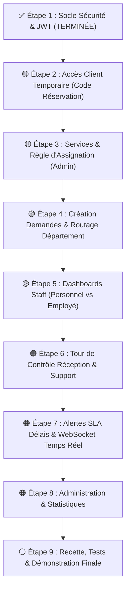

# 🏨 Plan de Développement — Plateforme de Digitalisation des Services Intra-Hôteliers
**Projet Académique — Angular & Spring Boot**  
**Binôme :** El Allouche Zakariyae (Personne A) & Mohammed Aymane Saber (Personne B)  
**Dernière mise à jour :** 2 novembre 2026

---

## 1. Vision et Règles Métier Clés

### 1.1 Rôles et responsabilités opérationnelles
1. **Client** : Accède à son espace via son **code temporaire de réservation** (ou compte). Consulte les services actifs, crée des demandes, suit l'avancement en temps réel, et peut solliciter la Réception en cas de besoin.
2. **Employé de département (Agent de terrain)** : Exécute physiquement les tâches (valet, femme de ménage, cuisinier/serveur, technicien). Il voit son tableau de bord de département, prend les tâches auto-assignables, ou reçoit les tâches assignées par son superviseur, met à jour les statuts (`IN_PROGRESS`, `COMPLETED`), et signale les éventuelles impossibilités.
3. **Personnel (Superviseur / Responsable de Département)** : Coordinateur au sein de son département (Gouvernante générale, Chef de rang, Responsable technique).
   - Consulte toutes les demandes de son département.
   - **Affecte les tâches nécessitant supervision** aux employés de son équipe.
   - Réassigne les tâches en cas de surcharge.
   - Reçoit les **alertes si une tâche n'est pas terminée** dans les délais.
4. **Réceptionniste (Tour de contrôle & Support Client)** :
   - **Observateur / Support** : Dispose d'une vue transversale globale sur toutes les chambres et tous les départements.
   - **Help Desk** : Si le client ne trouve personne ou s'impatiente, il contacte la réception qui consulte l'état en temps réel pour le renseigner.
   - **Création de secours** : Peut saisir une demande au nom d'un client (ex: commande passée par téléphone ou au comptoir).
5. **Administrateur** : Configure les comptes, les rôles, les départements et surtout le **mode d'assignation de chaque service**.

---

### 1.2 Règle d'assignation des services (Configurable par l'Admin)
Dans le catalogue des services, chaque service dispose d'un paramètre défini par l'Admin : `necessiteSupervision` (booléen) :
- **Si `necessiteSupervision == false` (Tâche Standard / Simple)** :
  - *Exemples* : Apport de serviettes, bouteille d'eau, réveil téléphonique, débarrassage plateau.
  - *Flux* : La demande arrive dans le pool du département ➔ Tout employé disponible du département peut cliquer sur **"Prendre en charge"** directement sans attendre le superviseur.
- **Si `necessiteSupervision == true` (Tâche Complexe / Sensible)** :
  - *Exemples* : Dépannage électrique/plomberie lourd, repas gastronomique spécial, navette chauffeur VIP, pressing délicat.
  - *Flux* : La demande arrive avec le statut `EN_ATTENTE_AFFECTATION` ➔ Seul le **Personnel (Superviseur)** peut choisir et **affecter un employé qualifié**. L'employé de terrain ne peut pas l'auto-valider.

---

### 1.3 Système d'alerte et de notification si tâche non terminée (Gestion SLA)
- Chaque service a une `dureeEstimee` en minutes.
- **Délai limite** = `dateCreation + dureeEstimee`.
- **Rappels automatiques** :
  1. **Alerte non prise en charge (10 min)** : Si aucune prise en charge après 10 min ➔ Notification sonore/push aux membres du département.
  2. **Alerte dépassement de délai (Retard)** : Si `now() > Délai limite` et tâche non `COMPLETED` ➔ Marquage visuel rouge ("En retard") + Notification prioritaire à l'employé assigné ET au Personnel (superviseur).
  3. **Escalade support Réception** : Si le retard dépasse un seuil critique (+15 min) ➔ Signalement visible sur l'écran du Réceptionniste pour anticiper un appel mécontent du client.

---

## 2. Répartition du Travail par Personne

| Domaine | 🔵 Personne A — Zakariyae (Backend & Données) | 🟢 Personne B — Aymane Saber (Frontend & UX) |
|---|---|---|
| **Socle & Auth** | Spring Security, BCrypt, JWT, RBAC ✅ | Intercepteur JWT, AuthGuard, RoleGuard, Login bimodal |
| **Accès Client** | Endpoint `POST /api/auth/guest-access`, validation réservation & code | Écran saisie code réservation, dashboard séjour (chambre, dates) |
| **Services & Admin** | Entité `Service` avec flag `necessiteSupervision`, CRUD Admin | Interface catalogue client + Configuration des services Admin |
| **Demandes & Routage** | `POST /api/requests`, routage département, statuts (`CREATED`, `IN_PROGRESS`, etc.) | Formulaire de demande client avec priorité et estimation |
| **Affectation & Staff** | Logique d'auto-prise en charge VS assignation par le Personnel | Dashboard Employé (mes tâches) + Dashboard Personnel (dispatch équipe) |
| **Supervision Réception** | Endpoint vue globale pour la Réception, filtres transversaux | Écran "Tour de contrôle" Réceptionniste + Recherche rapide par chambre |
| **Alertes & Délais** | Scheduler Spring `@Scheduled` calculant les dépassements de SLA | Badges d'urgence/retard visuels (rouge/clignotant), notifications sonores |
| **Temps Réel** | Configuration WebSocket/STOMP (topics département, queue client) | Service STOMP Angular, cloche de notifications en temps réel |
| **Statistiques** | Endpoints d'agrégation (délais moyens, volume par département) | Graphiques et indicateurs de performance (KPIs) |

---

## 3. Déroulement Chronologique des Étapes

---

### ✅ ÉTAPE 1 — Authentification & Sécurité (TERMINÉE)
- **Backend (Personne A)** : Spring Security, BCrypt, JJWT 0.12.6, `JwtAuthFilter`, `SecurityConfig`, `data.sql` avec hashes.
- **Frontend (Personne B)** : `jwtInterceptor`, `authGuard`, `roleGuard`, redirection par rôle.
- **Statut** : Validé et commité sur `seance4` / `feature/etape-2-acces-client`.

---

### 🟡 ÉTAPE 2 — Accès Client Temporaire (Code de Séjour)
> **Objectif :** Permettre au client d'accéder à son espace via son code réservation (sans mot de passe).

#### 🔵 Personne A (Backend) :
1. Créer le DTO `GuestAccessRequest` (`accessCode`).
2. Créer le DTO `GuestAccessResponse` (JWT client, nom, prénom, chambre, typeChambre, dates séjour).
3. Méthode dans `AuthService.guestLogin(code)` :
   - Vérifier `ClientAccessToken` : code existant, non révoqué, date non expirée.
   - Vérifier `Reservation` : statut `EN_COURS`, dates séjour englobant aujourd'hui.
   - Générer un JWT avec claims (`userId`, `role=CLIENT`, `numChambre`, `reservationId`).
4. Endpoint `POST /api/auth/guest-access` (autorisé en public dans `SecurityConfig`).
5. Ajouter des codes de test dans `data.sql` (ex: `RES-2026-001`).

#### 🟢 Personne B (Frontend) :
1. Mettre à jour `AuthService.ts` avec la méthode `guestLogin(code)`.
2. Mettre à jour `login.component.html` avec deux onglets bien distincts :
   - **Onglet "Espace Séjour Client"** : saisie du code de réservation (ex: `RES-2026-001`).
   - **Onglet "Espace Équipe Hôtelière"** : Email + mot de passe (Personnel, Employé, Réception, Admin).
3. Afficher dans `ClientDashboardComponent` les informations réelles du séjour (Numéro de chambre, nom du client, date de départ).

**Livrable :** Un client entre son code et accède immédiatement à son séjour en cours.

---

### 🟡 ÉTAPE 3 — Services & Règle d'Assignation (Admin)
> **Objectif :** Permettre à l'Admin de gérer les services et de configurer si le service nécessite l'intervention du Superviseur (Personnel).

#### 🔵 Personne A (Backend) :
1. Ajouter le champ `necessiteSupervision` (boolean, default false) dans l'entité `Service`.
2. DTOs `ServiceRequest` et `ServiceResponse` incluant ce champ et l'ID du département.
3. Endpoints :
   - `GET /api/services` (filtrable par `actif=true`, département).
   - `POST /api/services` (ADMIN) avec `necessiteSupervision`.
   - `PUT /api/services/{id}` et `PATCH /api/services/{id}/toggle`.

#### 🟢 Personne B (Frontend) :
1. Écran Catalogue Client : affichage des services disponibles avec délais estimés et catégories.
2. Écran Admin "Gestion des Services" :
   - Formulaire de création / modification d'un service.
   - Case à cocher : **"Nécessite affectation par le superviseur (Personnel)"**.
   - Sélecteur du département responsable.

**Livrable :** Chaque service est lié à son département et porte sa règle d'assignation.

---

### 🟡 ÉTAPE 4 — Création d'une Demande & Routage
> **Objectif :** Le client commande un service ; le système initialise la demande et l'aiguille vers le bon département.

#### 🔵 Personne A (Backend) :
1. Endpoint `POST /api/requests` :
   - Récupère le client connecté via le token JWT.
   - Vérifie que le service est actif.
   - Calcule le `tempsTraitementEstime` et assigne le département du service.
   - Si `service.necessiteSupervision == true` ➔ statut initial = `CREATED` (attente superviseur).
   - Si `service.necessiteSupervision == false` ➔ statut initial = `CREATED` (disponible dans le pool pour auto-prise en charge).
   - Génère la référence unique (ex: `DEM-2026-042`).
2. Entité `RequestStatusHistory` : historise chaque transition de statut avec horodatage et auteur.

#### 🟢 Personne B (Frontend) :
1. Formulaire client de demande de service :
   - Choix des options/besoins spécifiques.
   - Sélecteur de priorité (`NORMALE`, `HAUTE`, `URGENTE`).
   - Zone de texte "Instructions particulières" (allergie, discrétion...).
2. Écran de confirmation avec référence et délai prévisionnel.
3. Page "Mes demandes en cours" avec statut mis à jour.

**Livrable :** Le client crée sa demande, routée automatiquement vers le bon département.

---

### 🟡 ÉTAPE 5 — Traitement Staff : Personnel (Superviseur) vs Employé (Agent)
> **Objectif :** Deux vues staff adaptées au département : le superviseur qui affecte, l'employé qui réalise.

#### 🔵 Personne A (Backend) :
1. Ajuster `Affectation.java` :
   - `demande`, `employe` (exécutant), `personnel` (superviseur ayant affecté), `dateAffectation`.
2. Endpoints sécurisés :
   - `GET /api/requests/department` : réservé au staff du département de l'utilisateur.
   - `PATCH /api/requests/{id}/claim` (Employé) : auto-prise en charge (uniquement si `service.necessiteSupervision == false`). Statut ➔ `IN_PROGRESS`.
   - `PATCH /api/requests/{id}/assign` (Personnel) : affectation manuelle à un employé du département (`employeId`). Statut ➔ `ACKNOWLEDGED`.
   - `PATCH /api/requests/{id}/status` : changement de statut (`IN_PROGRESS`, `COMPLETED`, `REJECTED` avec motif).

#### 🟢 Personne B (Frontend) :
1. **Vue Employé (Agent de terrain)** :
   - Onglet "Mes tâches assignées" (tâches qui lui ont été affectées).
   - Onglet "Tâches disponibles du département" (auto-prise en charge en un clic pour les tâches directes).
   - Boutons d'action : "Démarrer", "Terminer", "Signaler un problème".
2. **Vue Personnel (Superviseur de département)** :
   - Tableau de bord de toutes les tâches du département.
   - Mise en évidence des tâches **en attente d'affectation**.
   - Menu déroulant avec la liste des employés de son département pour assigner la tâche.
   - Bouton de réassignation en cas de besoin.

**Livrable :** Le superviseur gère son équipe et ses affectations, l'employé traite ses tâches.

---

### 🟠 ÉTAPE 6 — Réception : Tour de Contrôle & Support Client
> **Objectif :** Donner au Réceptionniste la visibilité globale pour assister le client et superviser l'activité.

#### 🔵 Personne A (Backend) :
1. Endpoint `GET /api/reception/overview` :
   - Liste de toutes les demandes de l'hôtel avec filtres multi-critères : par chambre, par département, par statut, par urgence.
2. Endpoint `POST /api/reception/requests` :
   - Permet au réceptionniste de créer une demande pour une chambre si le client appelle ou vient au comptoir.

#### 🟢 Personne B (Frontend) :
1. **Écran Réception "Tour de Contrôle"** :
   - Barre de recherche instantanée par numéro de chambre (ex : tape "201" ➔ voit tout le séjour et les demandes de la suite 201).
   - Badges de suivi : chambre, département en charge, employé assigné, temps écoulé.
   - Bouton "Contacter le département" ou "Relancer la demande".
   - Formulaire rapide de saisie de commande au nom d'une chambre.

**Livrable :** La réception supervise l'hôtel et renseigne immédiatement tout client qui appelle.

---

### 🟠 ÉTAPE 7 — Alertes Délais (SLA) & Notifications Temps Réel (WebSocket)
> **Objectif :** Aucune tâche oubliée grâce à la détection de retard et aux notifications STOMP.

#### 🔵 Personne A (Backend) :
1. Dépendance `spring-boot-starter-websocket` et configuration STOMP (`/ws`, broker `/topic`, `/queue`).
2. Service de détection de retard `@Scheduled(fixedRate = 60000)` (toutes les minutes) :
   - Calcule pour chaque tâche : `dateCreation + tempsTraitementEstime`.
   - Si dépassé et non clôturé ➔ Publication d'une alerte sur `/topic/alerts/{departementId}`.
   - Si retard critique (+15 min) ➔ Publication sur `/topic/alerts/reception`.
3. Publication temps réel lors de : création de demande, assignation, changement de statut.

#### 🟢 Personne B (Frontend) :
1. Intégration du client WebSocket STOMP (`@stomp/stompjs`).
2. Indicateurs visuels d'urgence :
   - Les cartes en retard s'affichent avec une bordure rouge et un badge clignotant **"En retard (+X min)"**.
3. Centre de notifications (icône cloche avec compteur d'alertes non lues).
4. Notification temps réel côté client quand son statut passe à `IN_PROGRESS` ou `COMPLETED`.

**Livrable :** Les alertes de retard sont déclenchées automatiquement et visibles instantanément.

---

### 🟠 ÉTAPE 8 — Administration Avancée & Statistiques
> **Objectif :** Indicateurs de performance pour la direction et gestion complète.

#### 🔵 Personne A (Backend) :
1. Endpoints statistiques `GET /api/statistics/requests` :
   - Temps moyen de traitement par département.
   - Taux de respect des délais (SLA %).
   - Volume de demandes par tranche horaire et par service.
2. CRUD complet Admin pour utilisateurs, départements et services.

#### 🟢 Personne B (Frontend) :
1. Dashboard de statistiques avec cartes KPI et graphiques visuels.
2. Interface complète d'administration (gestion des comptes, rôles, associations départementales).

**Livrable :** Tableaux de bord de pilotage opérationnel pour l'Admin et le Personnel.

---

### ⚪ ÉTAPE 9 — Tests, Polish & Démonstration Finale
- **Tests unitaires et d'intégration** (Spring Boot `@SpringBootTest` + Angular tests).
- **Validation du parcours complet de bout en bout** :
  1. Client accède avec son code `RES-2026-001` (chambre 201).
  2. Client commande un service simple (auto-prise par l'employé).
  3. Client commande un service complexe (affecté par le superviseur Personnel).
  4. Simulation d'un retard ➔ Alerte au superviseur et visibilité à la réception.
  5. Clôture de la tâche avec notification au client.
- **Vérification responsive** (smartphone pour le client et la gouvernante, desktop pour la réception).

---

## 4. Matrice de Coordination

| Semaine | Personne A (Backend - Zakariyae) | Personne B (Frontend - Aymane Saber) | Résultat Validé |
|---|---|---|---|
| **S1** | ✅ JWT + Spring Security + BCrypt | ✅ Interceptor + Guards + Login base | **Étape 1 validée** |
| **S1** | DTOs & endpoint `POST /api/auth/guest-access` | Interface login bimodal (Client vs Staff) | **Accès client opérationnel** |
| **S2** | Modèle `Service.necessiteSupervision` + CRUD | Catalogue client + Config Admin des services | **Services & règles configurés** |
| **S2** | `POST /api/requests` + Routage département | Formulaire de demande + Historique client | **Demande créée et routée** |
| **S3** | Endpoints claim (employé) vs assign (personnel) | Dashboard Employé vs Dashboard Personnel | **Traitement et dispatch staff** |
| **S3** | Endpoints vue globale Réception + filtres | Écran "Tour de contrôle" Réceptionniste | **Support Réception actif** |
| **S4** | WebSocket STOMP + Scheduler alerte retard SLA | Service WS + Badges rouge retard + notifs | **Alertes temps réel actives** |
| **S4** | Endpoints de statistiques & KPIs | Écran stats + Administration globale | **Pilotage & Stats finis** |
| **S5** | Tests backend + doc API Swagger | Tests responsive + démo finale bilingue | **Projet prêt pour soutenance** |
