# 🏨 Plan de développement — Digitalisation des Services Intra-Hôteliers
> **Dernière analyse :** 2 novembre 2026 — Basé sur l'état réel du code source

---

## 📊 État actuel du projet

### Ce qui est réellement fait ✅

| Couche | Fichier / Fonctionnalité | État |
|---|---|---|
| **Backend — Entités** | `Utilisateur`, `Client`, `Employe`, `Receptionniste`, `Agent`, `Personnel` | ✅ Fait |
| **Backend — Entités** | `Chambre`, `Reservation`, `Departement`, `Service`, `Demande` | ✅ Fait |
| **Backend — Entités** | `Affectation`, `Notification`, `ClientAccessToken`, `Caracteristiques` | ✅ Fait |
| **Backend — Enums** | `Role`, `StatutDemande`, `PrioriteDemande` | ✅ Fait |
| **Backend — Auth** | `POST /api/auth/login` sans JWT (mot de passe en clair) | ⚠️ Partiel |
| **Backend — DTO** | `LoginRequest`, `LoginResponse`, `DemandeRequest`, `DemandeUpdateRequest` | ✅ Fait |
| **Backend — Repos** | Tous les repositories JPA de base | ✅ Fait |
| **Backend — Services** | `AuthService`, `DemandeService`, `DepartementService`, `ServiceHotelService`, `UtilisateurService` | ✅ Fait |
| **Backend — Controllers** | `AuthController`, `DemandeController`, `ServiceController`, `DepartementController`, `ChambreController`, `ClientController`, `ReservationController`, `UtilisateurController` | ⚠️ À vérifier |
| **Backend — Sécurité** | Spring Security, BCrypt, JWT | ❌ Absent |
| **Backend — WebSocket** | Configuration STOMP | ❌ Absent |
| **Backend — Statistiques** | `GET /api/statistics/requests` | ❌ Absent |
| **Frontend — Modèles** | Tous les modèles TypeScript définis | ✅ Fait |
| **Frontend — Services** | `AuthService`, `DemandeService`, `DepartementService`, `ServiceService`, `ChambreService`, `ReservationService` | ✅ Fait |
| **Frontend — Pages** | Login, Welcome/Landing | ✅ Fait |
| **Frontend — Pages** | Client Dashboard, Staff Dashboard, Admin CRUD | ⚠️ Squelettes |
| **Frontend — Routes** | `/`, `/login`, `/client`, `/staff`, `/admin` | ✅ Fait |
| **Frontend — Guards JWT** | `AuthGuard`, interceptor HTTP | ❌ Absent |
| **Frontend — Client Access** | Formulaire accès temporaire (code réservation) | ❌ Absent |
| **Frontend — Notifications** | Service WebSocket Angular, centre de notifs | ❌ Absent |
| **Données de démo** | `data.sql` avec 4 départements, 7 services, 5 chambres, 3 réservations | ✅ Fait |

### ⚠️ Problèmes critiques à résoudre en priorité

1. **Mots de passe en clair dans `data.sql` et `AuthService`** — le login compare `email + motDePasse` sans hash
2. **Spring Security absente** — aucun endpoint n'est protégé actuellement
3. **JWT absent** — le frontend ne stocke pas de token, les routes ne sont pas gardées
4. **`pom.xml` ne contient pas** `spring-boot-starter-security` ni la dépendance JWT (`jjwt`)
5. **Les statuts de `Demande`** utilisent `EN_ATTENTE` / `EN_COURS` mais le CDC demande `CREATED`, `ACKNOWLEDGED`, `IN_PROGRESS`, `COMPLETED`

---

## 🗺️ Vue d'ensemble du parcours restant

```mermaid
flowchart LR
    A["✅ Étape 0\nSocle & entités"] --> B["🔴 Étape 1\nJWT + Security"]
    B --> C["🟡 Étape 2\nAccès client temporaire"]
    C --> D["🟡 Étape 3\nCatalogue services"]
    D --> E["🟡 Étape 4\nCréation demande"]
    E --> F["🟡 Étape 5\nTraitement staff"]
    F --> G["🟠 Étape 6\nSuivi client + historique"]
    G --> H["🟠 Étape 7\nWebSocket STOMP"]
    H --> I["🟠 Étape 8\nAdmin + Statistiques"]
    I --> J["⚪ Étape 9\nTests + Démo finale"]
```



---

## 👥 Répartition par personne

### 🔵 Personne A — El Allouche Zakariyae (Backend + Sécurité)
Responsable de : Spring Boot, API REST, base de données, sécurité, WebSocket

### 🟢 Personne B — Mohammed Aymane Saber (Frontend + Intégration)
Responsable de : Angular, pages, formulaires, guards, WebSocket côté client

---

## 📋 Plan détaillé — Étape par étape

---

### 🔴 ÉTAPE 1 — Sécurisation de l'authentification (JWT + Spring Security)
> **Prérequis :** Aucun — à faire maintenant  
> **Durée estimée :** 2–3 jours

#### 🔵 Personne A (Backend)

**1.1 — Ajouter les dépendances dans `pom.xml`**
```xml
<!-- Spring Security -->
<dependency>
  <groupId>org.springframework.boot</groupId>
  <artifactId>spring-boot-starter-security</artifactId>
</dependency>
<!-- JWT (jjwt) -->
<dependency>
  <groupId>io.jsonwebtoken</groupId>
  <artifactId>jjwt-api</artifactId>
  <version>0.12.6</version>
</dependency>
<dependency>
  <groupId>io.jsonwebtoken</groupId>
  <artifactId>jjwt-impl</artifactId>
  <version>0.12.6</version>
  <scope>runtime</scope>
</dependency>
<dependency>
  <groupId>io.jsonwebtoken</groupId>
  <artifactId>jjwt-jackson</artifactId>
  <version>0.12.6</version>
  <scope>runtime</scope>
</dependency>
<!-- Validation -->
<dependency>
  <groupId>org.springframework.boot</groupId>
  <artifactId>spring-boot-starter-validation</artifactId>
</dependency>
```

**1.2 — Hasher les mots de passe dans `data.sql`**
- Utiliser BCrypt pour remplacer les mots de passe en clair
- Commande utile : `BCryptPasswordEncoder encoder = new BCryptPasswordEncoder(); encoder.encode("client123");`

**1.3 — Créer la configuration de sécurité**
- `security/SecurityConfig.java` : définir les routes publiques vs protégées
- `security/JwtUtil.java` : générer et valider les tokens
- `security/JwtAuthFilter.java` : filtre qui lit le token dans le header `Authorization: Bearer`
- Implémenter `UserDetailsService` sur `Utilisateur`

**1.4 — Modifier `AuthService` et `AuthController`**
- `login()` doit utiliser `BCryptPasswordEncoder.matches()`
- Retourner le JWT dans `LoginResponse`
- Ajouter le champ `token` dans `LoginResponse`

**1.5 — Protéger les endpoints par rôle**
```java
// Exemples de protection
.requestMatchers("/api/auth/**").permitAll()
.requestMatchers("/api/admin/**").hasRole("ADMIN")
.requestMatchers("/api/requests/**").hasAnyRole("STAFF", "ADMIN", "CLIENT")
```

**1.6 — Configurer CORS proprement**
- Supprimer `@CrossOrigin` sur chaque controller
- Centraliser dans `SecurityConfig`

#### 🟢 Personne B (Frontend)

**1.7 — Créer `JwtInterceptor`**
```typescript
// core/interceptors/jwt.interceptor.ts
// Ajouter Authorization: Bearer <token> à chaque requête HTTP
```

**1.8 — Créer `AuthGuard`**
```typescript
// core/guards/auth.guard.ts
// Vérifier localStorage, rediriger vers /login si absent
```

**1.9 — Stocker et décoder le JWT**
- Stocker `token` et `role` dans `localStorage` au login
- Lire l'expiration du token pour détecter une session expirée
- `AuthService.logout()` : effacer localStorage et rediriger

**1.10 — Protéger toutes les routes**
```typescript
// app.routes.ts
{ path: 'client', canActivate: [AuthGuard], ... }
{ path: 'staff', canActivate: [AuthGuard], ... }
{ path: 'admin', canActivate: [AuthGuard], ... }
```

**✅ Livrable Étape 1 :** Login sécurisé BCrypt + JWT, routes gardées, session persistée

---

### 🟡 ÉTAPE 2 — Accès client temporaire (code de réservation)
> **Prérequis :** Étape 1 terminée  
> **Durée estimée :** 1–2 jours

#### 🔵 Personne A (Backend)

**2.1 — Compléter `ClientAccessToken`**
- Vérifier que l'entité contient : `token`, `dateExpiration`, `reservation`, `client`
- Créer `POST /api/auth/guest-access` :
  - Valider que le code existe et que la réservation est `EN_COURS`
  - Retourner un token d'accès limité + infos chambre + dates séjour
  - Refuser si code expiré ou réservation inactive

**2.2 — Adapter Spring Security pour les guests**
- Le token client peut être un JWT avec `role = GUEST` et `reservationId` en claim

#### 🟢 Personne B (Frontend)

**2.3 — Page d'accès client**
- Formulaire de saisie du code d'accès (ex. `RES-2026-001`)
- Afficher message d'erreur si code invalide / expiré
- Afficher : chambre, dates du séjour après connexion réussie
- Stocker token guest dans `localStorage`

**✅ Livrable Étape 2 :** Un client accède à son espace uniquement avec un code valide lié à un séjour actif

---

### 🟡 ÉTAPE 3 — Catalogue des services
> **Prérequis :** Entités `Service` et `Departement` existantes ✅  
> **Durée estimée :** 1–2 jours

#### 🔵 Personne A (Backend)

**3.1 — Vérifier et corriger `ServiceController`**
- `GET /api/services` → retourner uniquement les services avec `disponibilite = true`
- `GET /api/services/{id}` → détail d'un service
- `POST /api/services` → créer (ADMIN uniquement)
- `PUT /api/services/{id}` → modifier (ADMIN)
- `PATCH /api/services/{id}/toggle` → activer/désactiver (ADMIN)
- Créer un DTO `ServiceResponse` (ne pas exposer l'entité directement)

**3.2 — Vérifier `DepartementController`**
- `GET /api/departements` → liste des départements

#### 🟢 Personne B (Frontend)

**3.3 — Page catalogue client**
- Grille de services avec image, nom, description, délai estimé
- Filtre par département (onglets ou liste déroulante)
- Badge "Indisponible" pour les services désactivés
- Bouton "Demander" → naviguer vers formulaire de demande

**3.4 — Page gestion des services (Admin)**
- Tableau avec actions : Modifier, Activer/Désactiver
- Formulaire de création / modification

**✅ Livrable Étape 3 :** L'admin gère les services, le client voit le catalogue filtré

---

### 🟡 ÉTAPE 4 — Création d'une demande
> **Prérequis :** Catalogue + accès client  
> **Durée estimée :** 2 jours

#### 🔵 Personne A (Backend)

**4.1 — Corriger les statuts `StatutDemande`**
- Aligner l'enum avec le CDC : `CREATED`, `ACKNOWLEDGED`, `IN_PROGRESS`, `COMPLETED`, `WAITING`, `CANCELLED`, `REJECTED`, `ESCALATED`
- (Remplacer `EN_ATTENTE`, `EN_COURS` si différents)

**4.2 — Vérifier/corriger `DemandeController` + `DemandeService`**
- `POST /api/requests` :
  - Vérifier que le service est actif (refus si désactivé)
  - Lire le client depuis le token JWT
  - Associer automatiquement le département du service
  - Initialiser le statut à `CREATED`
  - Générer la `referenceDemande`
- DTO : `DemandeRequest` (serviceId, description, priorite)
- DTO : `DemandeResponse` (id, reference, statut, service, departement, dateCreation, ...)

**4.3 — Créer `RequestStatusHistory`**
- Entité : `id`, `demande`, `ancienStatut`, `nouveauStatut`, `dateChangement`, `changedBy`
- Enregistrer chaque changement de statut

#### 🟢 Personne B (Frontend)

**4.4 — Formulaire de création de demande**
- Pré-sélection du service depuis le catalogue
- Champ description (textarea)
- Sélecteur de priorité : Normale / Haute / Urgente
- Bouton confirmer → appel `POST /api/requests`
- Page de confirmation avec numéro de demande

**✅ Livrable Étape 4 :** Le parcours complet de création d'une demande client

---

### 🟡 ÉTAPE 5 — Tableau de bord du personnel
> **Prérequis :** Demandes créées et persistées  
> **Durée estimée :** 2–3 jours

#### 🔵 Personne A (Backend)

**5.1 — Endpoint liste des demandes**
- `GET /api/requests` filtré selon le rôle :
  - `STAFF` → demandes du département de l'employé
  - `ADMIN`/`RECEPTIONNISTE` → toutes les demandes
  - `CLIENT` → uniquement ses propres demandes
- Paramètres de filtre : `?statut=`, `?departementId=`, `?priorite=`
- Pagination obligatoire (`Pageable`)

**5.2 — Endpoint changement de statut**
- `PATCH /api/requests/{id}/status` → body `{ "statut": "IN_PROGRESS", "note": "..." }`
- Enregistrer dans `RequestStatusHistory`
- Vérifier que l'employé a le droit de modifier cette demande

**5.3 — Endpoint affectation**
- `PATCH /api/requests/{id}/assign` → body `{ "employeId": 3 }`

#### 🟢 Personne B (Frontend)

**5.4 — Dashboard staff**
- Liste des demandes avec colonnes : Référence, Client, Chambre, Service, Priorité, Statut, Date
- Badges de statut colorés (CREATED=gris, ACKNOWLEDGED=bleu, IN_PROGRESS=orange, COMPLETED=vert)
- Filtres par statut / priorité / département
- Actions rapides : Prendre en charge → `ACKNOWLEDGED`, Démarrer → `IN_PROGRESS`, Terminer → `COMPLETED`

**5.5 — Détail d'une demande (modal ou page)**
- Informations complètes
- Timeline des changements de statut
- Champ note interne (invisible pour le client)
- Bouton réassigner

**✅ Livrable Étape 5 :** Le personnel reçoit, traite et met à jour les demandes selon ses droits

---

### 🟠 ÉTAPE 6 — Suivi client et historique
> **Prérequis :** Cycle de vie des demandes fonctionnel  
> **Durée estimée :** 1 jour

#### 🔵 Personne A (Backend)

**6.1 — Sécuriser l'accès client à ses demandes**
- `GET /api/requests` pour CLIENT ne retourne que ses demandes (filtrer par `clientId` extrait du JWT)
- `GET /api/requests/{id}` : vérifier que la demande appartient au client connecté (sinon 403)
- `PATCH /api/requests/{id}/cancel` : annulation possible uniquement si statut = `CREATED`

#### 🟢 Personne B (Frontend)

**6.2 — Page "Mes demandes" (espace client)**
- Liste des demandes en cours
- Badge de statut avec libellé français : Créée / Reçue / En cours / Terminée / Annulée
- Timeline des changements de statut (historique)
- Bouton "Annuler" visible uniquement si statut = `CREATED`

**✅ Livrable Étape 6 :** Le client peut suivre ses demandes et voir l'historique

---

### 🟠 ÉTAPE 7 — Notifications temps réel (WebSocket / STOMP)
> **Prérequis :** Changements de statut fonctionnels  
> **Durée estimée :** 2 jours

#### 🔵 Personne A (Backend)

**7.1 — Ajouter la dépendance WebSocket**
```xml
<dependency>
  <groupId>org.springframework.boot</groupId>
  <artifactId>spring-boot-starter-websocket</artifactId>
</dependency>
```

**7.2 — Configurer STOMP**
```java
// config/WebSocketConfig.java
@Configuration
@EnableWebSocketMessageBroker
public class WebSocketConfig implements WebSocketMessageBrokerConfigurer {
    // endpoint: /ws
    // broker: /topic (broadcast), /queue (privé)
    // prefix app: /app
}
```

**7.3 — Publier les événements**
- Lors de la création d'une demande → publier sur `/topic/departement/{id}/requests`
- Lors d'un changement de statut → publier sur `/queue/client/{clientId}/notifications`
- Lors d'une demande urgente → publier sur `/topic/urgent`

**7.4 — Créer `NotificationService`**
- Persister les notifications en base
- Marquer comme lu : `PATCH /api/notifications/{id}/read`
- `GET /api/notifications` → liste des notifs non lues

#### 🟢 Personne B (Frontend)

**7.5 — Service WebSocket Angular**
```typescript
// core/services/websocket.service.ts
// Utiliser @stomp/stompjs ou rxStomp
// Reconnecter automatiquement si déconnexion
```

**7.6 — Centre de notifications**
- Icône cloche dans le header avec badge de compteur
- Dropdown des notifications récentes
- Cliquer → marquer comme lu
- Fallback : polling `GET /api/notifications` toutes les 30s si WebSocket indisponible

**✅ Livrable Étape 7 :** Notification temps réel lors des événements importants avec fallback HTTP

---

### 🟠 ÉTAPE 8 — Administration et statistiques
> **Prérequis :** Toutes les fonctionnalités précédentes  
> **Durée estimée :** 2 jours

#### 🔵 Personne A (Backend)

**8.1 — Gestion des utilisateurs**
- `GET /api/admin/users` — liste du personnel
- `POST /api/admin/users` — créer un compte
- `PUT /api/admin/users/{id}` — modifier
- `PATCH /api/admin/users/{id}/role` — changer le rôle

**8.2 — Gestion des départements**
- CRUD complet sur `/api/admin/departements`

**8.3 — Endpoint statistiques**
```java
// GET /api/statistics/requests
// Retourner :
// - total demandes par période (jour/semaine/mois)
// - répartition par département
// - répartition par statut
// - temps moyen de traitement
// - demandes urgentes non résolues
```

#### 🟢 Personne B (Frontend)

**8.4 — Page administration**
- Onglets : Utilisateurs | Départements | Services
- CRUD complet pour chaque onglet
- (Améliorer `admin-crud.component` existant)

**8.5 — Tableau de bord statistiques**
- Cartes KPI : total demandes, en cours, terminées, temps moyen
- Graphique barres : demandes par département
- Graphique lignes : évolution sur la période
- Filtres : Aujourd'hui / Cette semaine / Ce mois

**✅ Livrable Étape 8 :** L'admin configure la plateforme et le personnel consulte les indicateurs

---

### ⚪ ÉTAPE 9 — Tests, polish et démonstration finale
> **Travail commun — Durée estimée : 2–3 jours**

#### 🔵 Personne A
- Tests unitaires : `AuthService`, `DemandeService`, règles métier
- Tests d'intégration : API + base de données avec `@SpringBootTest`
- Tests de sécurité : accès avec token expiré, accès cross-client
- Vérifier la pagination sur les listes volumineuses
- Documenter les endpoints (Swagger / OpenAPI ou fichier Markdown)

#### 🟢 Personne B
- Tests fonctionnels : 4 parcours complets (client, réception, employé, admin)
- Vérification responsive : smartphone, tablette, desktop
- Internationalisation : passer les libellés en FR/EN
- Messages d'erreur compréhensibles sur tous les formulaires
- Accessibilité : contraste, labels, navigation clavier

#### Commun
- Démonstration bout en bout avec les données de `data.sql`
- Créer un compte admin et se connecter
- Créer une demande en tant que client
- Traiter la demande en tant que staff
- Vérifier les notifications en temps réel

---

## 🔗 Ordre de coordination recommandé

| Semaine | Personne A | Personne B | Point de synchro |
|---|---|---|---|
| **S1** | JWT + Spring Security + BCrypt | AuthGuard + Interceptor + Routes gardées | ✅ Login sécurisé end-to-end |
| **S1** | Accès guest `/api/auth/guest-access` | Page accès client | ✅ Accès client temporaire |
| **S2** | Corriger ServiceController + DTO | Catalogue client + Admin services | ✅ Catalogue fonctionnel |
| **S2** | POST /api/requests + StatusHistory | Formulaire demande client | ✅ Création de demande |
| **S3** | GET /api/requests filtré + PATCH status | Dashboard staff + filtres | ✅ Traitement des demandes |
| **S3** | Accès client sécurisé + annulation | Page suivi client + timeline | ✅ Suivi client |
| **S4** | WebSocket STOMP + NotificationService | Service WS Angular + cloche notifs | ✅ Temps réel |
| **S4** | Admin endpoints + Statistiques | Pages admin + Dashboard stats | ✅ Administration |
| **S5** | Tests backend + doc API | Tests frontend + responsive + i18n | ✅ **Démo finale** |

---

## 🚨 Règles de coordination

> [!IMPORTANT]
> **Contrat API d'abord** : Personne A fournit le DTO et un exemple de réponse JSON avant que Personne B commence l'écran correspondant.

> [!WARNING]
> **Ne jamais exposer les entités JPA directement** dans les réponses API — toujours utiliser des DTO.

> [!NOTE]
> **Les permissions se vérifient côté backend** — même si le bouton est masqué côté Angular, le backend doit refuser la requête non autorisée.

> [!TIP]
> Mettre à jour `docs/SUIVI_DEVELOPPEMENT.md` après chaque tâche terminée pour garder la traçabilité.

---

## 📦 Dépendances manquantes à ajouter dans `pom.xml`

```xml
<!-- À ajouter immédiatement -->
spring-boot-starter-security
jjwt-api / jjwt-impl / jjwt-jackson (0.12.6)
spring-boot-starter-validation
spring-boot-starter-websocket

<!-- À ajouter pour les statistiques -->
<!-- Aucune dépendance externe nécessaire — JPQL suffit -->
```

## 📦 Packages Angular à ajouter

```bash
npm install @stomp/stompjs sockjs-client
npm install --save-dev @types/sockjs-client
```
